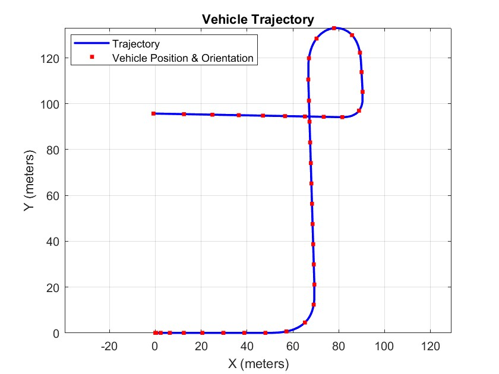
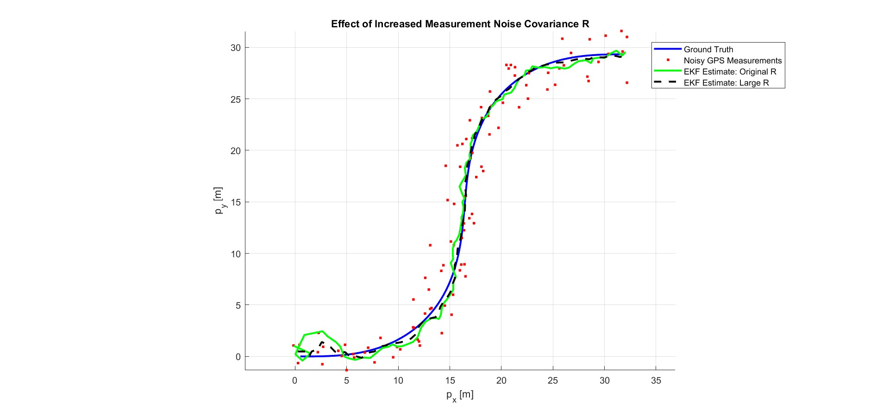
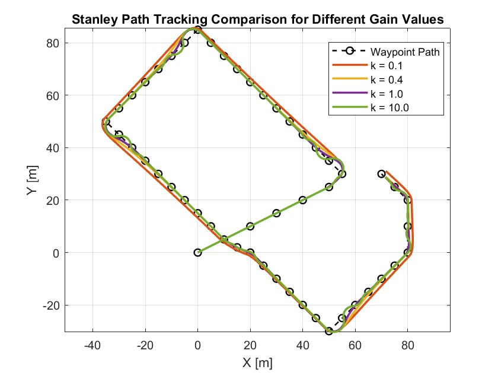

# KON 429E — Autonomous Vehicles

İstanbul Teknik Üniversitesi, **2025–2026 Bahar** dönemi Autonomous Vehicles dersi için hazırlanan MATLAB / Simulink ödevleri.

**Hazırlayan:** Atakan Kuşçu

## Ödevler

| Bölüm | Konu | Kod ve çalıştırma | Rapor |
| --- | --- | --- | --- |
| Ödev 1 | Doğrusal olmayan bisiklet araç modeli, lastik kuvvetleri ve kayma davranışı | [Assignment 01](assignments/assignment-01/README.md) | [PDF](assignments/assignment-01/reports/Autonomous_Vehicles_HW1.pdf) |
| Ödev 2 | EKF ile iki boyutlu konum ve yönelim kestirimi; ölçüm kovaryansı karşılaştırması | [Assignment 02](assignments/assignment-02/README.md) | [PDF](assignments/assignment-02/reports/Autonomous_Vehicles_HW2.pdf) |
| Ödev 3 | Stanley yol takibi ve denetleyici kazancı karşılaştırması | [Assignment 03](assignments/assignment-03/README.md) | [PDF](assignments/assignment-03/reports/Autonomous_Vehicles_HW3.pdf) |

## Klasör düzeni

```text
assignments/
  assignment-01/   # src/, models/, figures/, reports/
  assignment-02/   # src/, models/, data/, figures/, reports/
  assignment-03/   # src/, models/, figures/, reports/
docs/              # Taşıma kaydı, doğrulama ve sonraki işler
setup_autonomous.m # Ödev seçimi ve MATLAB yol ayarları
CONTRIBUTING.md    # Deney ve commit düzeni
```

## Başlangıç

MATLAB ve Simulink gerekir. Yerel doğrulama ortamı **MATLAB R2025b**'dir. Repo kökünde MATLAB'ı açıp ilk ödevi çalıştırın:

```matlab
setup_autonomous('hw1');
parameters;
sample_input;
out = sim('hw1_model');
sonuc;
```

`setup_autonomous('hw2')` ve `setup_autonomous('hw3')` diğer ödevlere geçer. Yardımcı fonksiyon çalışma klasörünü değiştirir; `src/`, `models/` ve varsa `data/` klasörlerini MATLAB yoluna ekler. Ödevler arasında geçerken çalışma alanını temizleyin ve o ödevin başlangıç scriptini yeniden çalıştırın.

Simulink modelleri çalışma alanındaki parametrelere bağımlıdır. `.slx` dosyasını doğrudan açmak parametreleri otomatik yüklemez; her ödevin README'sindeki sırayı izleyin.

## Örnek sonuçlar

### Ödev 1 — araç yörüngesi



### Ödev 2 — EKF ve ölçüm kovaryansı



### Ödev 3 — Stanley kazanç karşılaştırması



## Çalışma düzeni

Teslim kaynakları ve sonuçları ödev bazında arşivlenir. Simulink önbellekleri, autosave dosyaları, ders slaytları ve aynı dosyaların ZIP kopyaları Git dışında kalır. Yeni bir sonuç paylaşılırken kullanılan giriş profili, örnekleme süresi ve parametreler belirtilir.

- [Deney ve commit düzeni](CONTRIBUTING.md)
- [İş listesi](docs/ROADMAP.md)
- [Çalıştırma kontrolleri ve sınırlar](docs/VALIDATION.md)
- [Taşıma kaydı](docs/MIGRATION.md)

Grafik klasörlerindeki görseller önceki teslimlerden korunmuştur. Çalıştırma kontrollerinde elde edilen yeni sonuçlar bu görsellerin üzerine yazılmaz.
